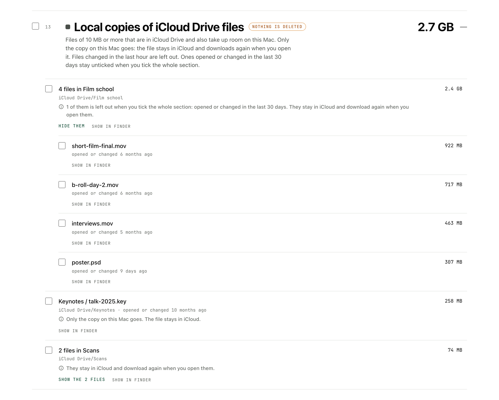
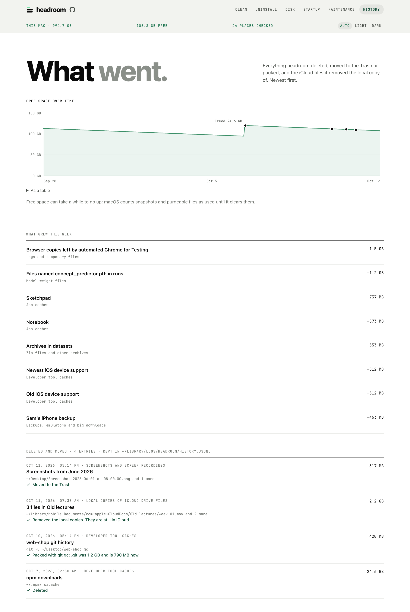

# headroom

My Mac ran out of space, so I made this to see what was eating it and clear the junk safely.
headroom finds caches and leftover files, shows how much space each one takes, and deletes only
what you tick.

It runs as a small page in your browser at `headroom.localhost`. Nothing about your files leaves
your Mac, and nothing goes until you confirm. The only thing it ever asks the internet is whether
there's a new version.

<picture>
  <source media="(prefers-color-scheme: dark)" srcset="docs/screenshots/clean-dark.png">
  
</picture>

## What it does

- **Cleaning**
  - Finds caches, logs, temp files, old installers, developer tool caches and build folders.
  - Finds what apps you already deleted left behind.
  - Shows the size of each. Deletes only what you tick, after you confirm, and can be stopped.
  - **Safe clean** picks only what can't hurt, in two clicks.
  - Packs a big `.git` folder with `git gc` instead of deleting anything.
  - A switch sends cleaned files to the Trash instead of deleting them.
  - **Never offer** hides a row you always want to keep.
- **Your files**
  - Lists model files, archives, screenshots, iPhone backups, and Mail and Messages attachments.
  - What may be yours goes to the Trash, never straight off. Safe clean picks none of it.
  - Files that belong together are one line that opens to every file, with **Show in Finder**.
- **Free space without deleting** (new, and not tried on a real iCloud Drive or Time Machine yet)
  - Removes the copy on this Mac of files that are safely in iCloud Drive. Off until you switch it on.
  - Shows Time Machine's local snapshots and removes them when you ask.
- **Apps**
  - Uninstalls an app together with what it keeps in your Library. It all goes to the Trash.
- **Disk**
  - Shows your biggest folders and files, old downloads and duplicate files.
- **Startup**
  - Lists what starts with your Mac. You can turn your own items off and on again.
- **Maintenance**
  - Refreshes Quick Look, flushes DNS, rebuilds the icon cache or the Spotlight index.
  - Says when a new version is out.
- **History and what grew**
  - A list of everything it removed, and a chart of free space over time.
  - What grew since about a week ago, so you see what is eating the disk.
- **Reminders**
  - A notification when space runs low, and one a week when Safe clean is worth running.
  - Nothing is ever deleted on its own.

## Getting started

You don't need Python or anything else, just macOS 12 or newer.

1. **Check which Mac you have.** Apple menu → About This Mac. If it says "Chip" (Apple M1, M2…)
   you have Apple Silicon. If it says "Processor" (Intel Core…) you have Intel.
2. **Download the zip** from the [latest release](https://github.com/ips610/headroom/releases/latest),
   under Assets:
   - `headroom-apple-silicon.zip` for Apple Silicon
   - `headroom-intel.zip` for Intel

   If you want to check the download first, get `SHA256SUMS` from the same place and run this
   in Terminal, in the folder with both files. It should say `OK`. (Safari unzips by itself and
   moves the zip to the Trash, so drag the zip back out first.)

   ```sh
   shasum -a 256 -c SHA256SUMS --ignore-missing
   ```
3. **Unzip it.** Safari does this by itself. Otherwise double-click the zip in Downloads. You get
   `headroom.app`.
4. **Move it to Applications.** Drag `headroom.app` onto Applications in the Finder sidebar. Don't
   run it from Downloads: the reminders and the `headroom.localhost` address are only set up
   when it runs from Applications.
5. **Open it the first time.** Double-click headroom in Applications. macOS says it can't check
   the app for malware, because I haven't paid Apple to notarise it. Click **Done** (not Move to
   Trash). Then open System Settings → Privacy & Security, scroll down to Security, and next to
   "headroom was blocked" click **Open Anyway**. Enter your password and click **Open Anyway**
   once more. You only do this once per download.
6. **Allow what it asks for.** headroom opens a page in your browser. macOS asks whether
   headroom may read Desktop, Documents and Downloads (that's where it finds build folders and
   old installers) and whether it may send notifications. Allow both. macOS may also say it
   added background items: those are the small helpers that make `headroom.localhost` and the
   reminders work. Some things need [Full Disk Access](#full-disk-access) as well.
7. **Clean.** Wait for the scan, then press **Safe clean** for the easy wins, or tick what you
   want and press Delete. Nothing goes until you confirm.

After that, open it from the Dock, Launchpad or Spotlight, or just type `headroom.localhost` in
your browser. The first time you type the address, a second tab opens and the first one says you
can close it: headroom signs a browser in by opening the tab itself. After that the browser stays
signed in for 30 days. Only your default browser gets signed in this way.

## Using it

### Opening and closing it

headroom has a Dock icon while it runs. Click it to bring the page back, and right-click it →
Quit (or ⌘Q) to stop headroom. Closing the tab stops it too.

You can type `headroom.localhost` even when headroom is closed, and it starts. macOS keeps that
address free for it, so nothing runs until you visit. (If Safari searches for it instead, type
`headroom.localhost/` once.) The page itself lives on port 8460, or the next free one if
something else has that. The plain name is a tiny redirect on port 80 that also knows
`harbor.localhost`, my other app.

The page comes in Light and Dark. **Auto · Light · Dark** sits at the top right. Auto follows
your Mac.

### Cleaning

Open headroom and it scans your Mac. The numbers from last time show straight away, greyed out,
and each section fills in again as it's measured. Homebrew, Docker and the simulators can take a
while to answer (and iCloud Drive, if you switched that on), so the scan doesn't wait for them.
You can already clean, and their rows fill in when they're ready.

Tick a whole section, or open it and pick single rows, then press **Delete**. The question that
follows lists what you picked and says for each row where it goes. A progress bar shows how it's
going, you can stop it, and you can keep picking while it runs: those picks go next.

Most of what you delete doesn't go to the Trash, so check what you tick. If you'd rather have a
safety net, turn on **Move cleaned files to the Trash instead of deleting them** under
Maintenance. Then nothing is deleted for good, and you get the space back when you empty the
Trash. Rows that only a command can clear (Homebrew, Docker, Ollama, simulators, `git gc`) and
the Trash itself are greyed out while it's on.

**Safe clean** is for when you just want space back. It picks only what can't hurt: app caches,
old logs and temp files, the browser copies automated Chrome leaves behind, and installers you
downloaded over a month ago. You still see the list before anything goes.

Some rows are held back on purpose:

- If an app is open, its cache is greyed out until you quit it, because the app would just write
  it back.
- Ticking a whole section leaves out build folders you used this week, installers from this
  week, and Xcode's two newest device support versions. Tick those one by one if you mean it.
- A row you never want to see again: hover it and press **Never offer**. It moves to "Never
  offered" at the bottom of the list, where you can bring it back.

A section that grew a lot since about a week ago says so next to its size, like "+4.2 GB this
week".

### Your own files

Below the caches there is a second group, marked "Check before deleting". These aren't caches,
and most of them won't come back on their own: leftovers of deleted apps, backups and emulators,
model weight files, archives, screenshots, and Mail and Messages attachments.

Files that belong together show as one line: a month of screenshots, the archives in one folder,
or a model file that a training run left in a hundred folders under the same name. The line says
how many there are, how big they are together and where they are. Press **Show the 118 files**
and you get every file with its own size, date and checkbox, largest first. Ticking the line
ticks all of them. Rows here also have **Show in Finder**, so you can look before you decide.



Screenshots and model files added or changed in the last 30 days stay unticked when you tick
the whole section. So do model files inside a git project.

**Mail and Messages attachments** need [Full Disk Access](#full-disk-access). Mail's are the
copies it made when you opened an attachment. The messages keep the originals. From Messages,
headroom lists files of 20 MB or more. Removing one leaves a blank spot in that conversation in
Messages on this Mac, so ticking the whole section never picks those: tick them one by one, or a
month at a time. If Messages in iCloud is on, the attachment may still be in iCloud. headroom
never reads your messages themselves.

### iCloud Drive and Time Machine

These two give space back without deleting a file of yours.

I don't use iCloud Drive or Time Machine on my own Mac, so I haven't been able to try these two
on the real thing. They go through macOS's own commands, and the iCloud one only touches files
macOS says are safely uploaded. If either misbehaves for you, please
[tell me](https://github.com/ips610/headroom/issues).

**Local copies of iCloud Drive files.** This one is off until you turn it on: Maintenance →
Cleaning → **Offer local copies of iCloud Drive files**. While it's off, headroom doesn't look at
iCloud Drive at all and the section isn't there.

A file in iCloud Drive that you opened on this Mac is kept on this Mac too. With the switch on,
headroom lists the ones of 10 MB or more that macOS says are uploaded, are the newest version,
and aren't syncing, paused or in conflict. Where macOS gives no answer, the file is left out. So
is any file that changed in the last hour, because "uploaded" doesn't promise that iCloud already
has the newest edit. It looks in iCloud Drive, and in Desktop and Documents when those are in
iCloud. (macOS marks the two folders as iCloud items when "Desktop & Documents Folders" is on.
That mark is what headroom reads.)

Press **Remove local copies** and macOS drops the copy on this Mac. The file stays in iCloud and
downloads again when you open it, which needs the Mac to be online. Sometimes macOS says yes and
frees the room a little later. Then headroom says it asked, and doesn't claim a size it couldn't
measure. Files opened or changed in the last 30 days stay unticked when you tick the whole
section. If the Mac is offline, or iCloud Drive isn't set up, the section says so and offers
nothing. The Move to Trash switch makes no difference here, because nothing is deleted.

**Time Machine local snapshots** are under Maintenance. Time Machine keeps hourly copies of your
disk on the disk itself for about a day, so you can restore a file without the backup disk. They
count as used space. headroom shows how many there are and how old the oldest is. macOS doesn't
say how big they are. **Remove them** does that. You lose the way to restore files from the last
day from this Mac's own disk. headroom lists and counts the snapshots of the startup disk, but
if another disk has a snapshot from the same moment, that one goes too. Backups on your backup
disk are untouched, and macOS would have removed the snapshots itself when it needed the room.
macOS may ask for an administrator's password.

Free space can take a while to go up after any of this: macOS counts snapshots and purgeable
files as used until it clears them.

### Uninstall

Lists your apps with their size, when you last used them and what they keep in your Library.
Uninstalling moves the app and those files to the Trash, so you can change your mind. Apple's
apps aren't listed, and an app has to be closed first.

### Disk

Shows the biggest folders in your home folder and Applications (click one to look inside), your
largest files, downloads you haven't touched in 90 days, and duplicate files in Downloads,
Desktop and Documents. You can show anything in Finder or move it to the Trash. For duplicates it
keeps the newest copy unless you pick another, and it skips files that live only in iCloud so
nothing downloads.

### Startup

Lists what starts with your Mac or when you log in: your own launch agents and the ones for
every user. You can turn your own off and on again. The others are shown only.

### Maintenance

Four fixes for when something looks stuck: refresh Quick Look, flush the DNS cache, rebuild the
icon cache, rebuild the Spotlight index. The ones that need your password ask through macOS's own
dialog, and headroom never sees it. Rebuilding Spotlight takes hours, so it asks first.

The same tab holds the Move to Trash switch, the switch for iCloud Drive's local copies, the Time
Machine snapshots, the reminders and the update check.

### History

A chart of free space over time, with a dot wherever headroom freed some. Then what grew since
about a week ago, sections and single rows, biggest first. Then everything headroom deleted,
moved to the Trash or packed, and the iCloud files it removed the local copy of, with when, what
and where. Files that went together are one entry, not one each.



The list is kept in `~/Library/Logs/headroom/history.jsonl`. For "what grew", headroom keeps the
sizes from one scan a day for 30 days. Until it has a scan from an earlier day it says "Not
enough history yet", and if the one it compares with isn't about a week old it says how many days
it is.

### Reminders

headroom tells you when free space drops below 20 GB. Once a week, if Safe clean would free
500 MB or more, it says how much. It checks every half hour in the background, never repeats
itself within six hours unless another 5 GB went, and never deletes anything on its own. Click a
notification and headroom opens. You can turn either reminder off, or change the 20 GB, under
Maintenance.

## What it cleans

| Section | What's in it |
| --- | --- |
| Trash and browser caches | the Trash, and the cache folders of Safari, Chrome, Firefox, Arc, Brave and Edge (never history, logins or cookies) |
| App caches | everything in `~/Library/Caches`, the cache folders of apps like Slack, VS Code and Notion, caches inside sandboxed apps, Spotify's and Adobe's media caches, qBittorrent's location database |
| Logs and temporary files | `~/Library/Logs`, qBittorrent's logs, temp files nobody has touched for a day, and the copies of itself that Chrome (or Edge, Brave, Chromium) leaves behind every time Selenium, Puppeteer or Playwright starts it, about 1 GB each. A copy a running browser was started from is left alone |
| Installer files | `.dmg`, `.pkg`, `.iso`, `.xip` and zipped apps in Downloads and on the Desktop, iPhone and iPad updates (`.ipsw`), and `.torrent` files you've already added to qBittorrent or that are over a month old |
| Developer tool caches | npm, Bun, Gradle, Maven, NuGet, gems, pub, Cargo, rustup, uv, Conda, Deno, Expo, Unity, Arduino, Go modules, Flutter, Xcode DerivedData, previews and device support, old simulators and the caches inside shut-down ones, Docker build cache, Homebrew's old versions and packages nothing needs, old VS Code / Cursor / Windsurf extension versions, `~/.cache`, the datasets Hugging Face downloaded and the code torch.hub downloaded. A project's `.git` folder over 500 MB gets a row that packs it with `git gc` |
| Project build folders | `node_modules`, `.next`, `dist`, Rust `target`, Swift `.build`, Flutter `build` and `.dart_tool` |
| Leftovers of deleted apps | settings, caches, saved windows, containers and launch agents of apps that aren't on your Mac any more |
| Backups, emulators and big downloads | iPhone and iPad backups, Android emulators and system images, iOS simulators, unused Docker images, stopped Docker containers and volumes no container uses, Xcode archives, unfinished downloads of torrents you removed from qBittorrent |
| Model weight files | models that Hugging Face, PyTorch, Ollama, LM Studio, GPT4All and Jan downloaded, one row each, and model files of 100 MB or more anywhere else in your home folder (`.gguf`, `.safetensors`, `.pt` and the like). A `.bin` or `.h5` only counts next to a `config.json` or `tokenizer.json`, or in a folder called `models` or `checkpoints` |
| Zip files and other archives | `.zip`, `.tar`, `.tar.gz`, `.tgz`, `.tar.bz2`, `.tar.xz`, `.7z` and `.rar` of 20 MB or more, and a plain `.gz`, `.bz2` or `.xz` from 100 MB. The ones with a folder of the same name next to them come first, because they look unzipped already |
| Screenshots and screen recordings | the ones macOS itself made, in the folder it saves them to (the Desktop unless you changed it), one line per month, newest month first |
| Mail and Messages attachments | the copies Mail made of attachments you opened, and files of 20 MB or more inside your Messages conversations, one line per month |
| Local copies of iCloud Drive files | files of 10 MB or more in iCloud Drive, and in Desktop and Documents when those are in iCloud, one line per folder. Only the copy on this Mac goes. Off until you switch it on under Maintenance, and files changed in the last hour are left out |

The last seven aren't caches. Most of them won't come back on their own, so headroom keeps them
apart and warns you before they go. The very last one deletes nothing.

These always go to the Trash and never straight off, whatever the switch says, because they're
yours or may be: iPhone and iPad backups, screenshots and screen recordings, archives, Mail and
Messages attachments, model files outside the tools' own folders (a `.pt` in a project may be a
model you trained, and nothing can download that again), and models in LM Studio, GPT4All and
Jan, which also hold the ones you import. Hugging Face models and torch.hub checkpoints are
deleted like any cache, since those folders only hold downloads.

headroom finds model files and archives by asking Spotlight, so it doesn't walk your disk a
second time, and then checks every answer itself. If Spotlight doesn't answer, the section says
so. If it's switched off for the disk, those two sections just stay empty, and screenshots are
found by their names only, which misses ones macOS named in another language than English.

## What it won't touch

Your actual app data (settings, chats, local storage) unless you uninstall the app or it's a
deleted app's leftovers. Docker volumes a container still uses. Virtualenvs. Apple's own caches
and apps. Any build folder that doesn't sit next to the file that proves what it is
(`package.json`, `Cargo.toml`, `Package.swift`, `pubspec.yaml`), and any build folder git tracks
files in. A deleted app's leftovers only show up when headroom is sure the app is gone.

With qBittorrent, it never touches your list of torrents, its settings or anything it finished
downloading. Only the half-downloaded pieces of torrents that aren't in the list any more, and
nothing of it while qBittorrent is open.

A picture you named `screenshot.png` yourself isn't a screenshot to headroom. It only lists files
macOS marked as screen captures or named the way macOS names them, date and time included, and
only in the one folder macOS saves them to, never its subfolders.

For model files and archives it skips `~/Library`, anything inside an app or the Photos library,
`node_modules`, `.git` and other hidden folders, virtualenvs, conda and Flutter installs,
archives inside a git project, and files that are only in iCloud. It never opens an archive to
look inside. Next to Hugging Face's downloads, only what is known to be a download is offered:
your login and whatever other tools keep in that folder stay.

A scan doesn't open anything that is only in iCloud, because opening it would download it. That
goes for a zip it would otherwise peek into to see if it holds an app, a `.torrent` file, and a
git repository whose own files are only in iCloud.

In a git repository it never deletes anything itself. It runs `git gc` and tells you how big
`.git` was before and after. Commits you can reach stay; git may remove unreachable ones older
than its grace period (two weeks, unless the repository says otherwise). It won't run that while
a rebase, merge, cherry-pick or bisect is half done or git holds a lock, nor in a partial clone
or a repository that shares its objects with another.

In iCloud Drive it does nothing unless you switched that on. Then it never touches a file that
is still uploading or downloading, isn't the newest version, has a conflict to settle or an
upload error, has its syncing paused, or changed in the last hour. Never a folder, a package like
a Pages document, or a hidden file. An archive, model file, installer or screenshot in an iCloud
Desktop or Documents stays in its own section.

In Mail it only looks at the copies of opened attachments, never the mailbox. In Messages it only
lists attachments of 20 MB or more and never opens the database of your conversations.

## Full Disk Access

macOS keeps these behind Full Disk Access:

- the Trash
- Safari's and Chrome's caches
- the caches inside sandboxed apps (WhatsApp, Zoom, Teams…)
- iPhone and iPad backups
- the copies Mail keeps of opened attachments
- Messages attachments

To let headroom see them, open System Settings → Privacy & Security → Full Disk Access, switch
on headroom (add it from Applications with + if it isn't there), then quit and reopen headroom.
Without it, headroom just tells you what it couldn't see.

## Updating and uninstalling

### Updating

When you open headroom, it asks GitHub whether there's a newer version, at most once a day. If
there is, the top bar says a new version is out, with a **Get it** link. Maintenance → Updates
has a **Check for updates** button too.

To update, quit headroom (right-click its Dock icon → Quit), download the new zip, unzip it and
drag headroom into Applications. Click **Replace** when Finder asks. A new download may need
Open Anyway once more. Your settings, history and "Never offered" list stay.

### Uninstalling

Quit headroom and drag it from Applications to the Trash. Then paste this into Terminal to
remove its helpers, settings and history:

```sh
for agent in local.headroom.door local.headroom.watch local.localhost.door; do
  launchctl bootout gui/$(id -u)/$agent 2>/dev/null
  rm -f ~/Library/LaunchAgents/$agent.plist
done
rm -rf ~/Library/Application\ Support/headroom ~/Library/Logs/headroom ~/Library/Logs/headroom.log
```

If you also use harbor, keep `local.localhost.door` (it serves `harbor.localhost` too): take it
out of the first line.

## Is it safe?

I was careful here because it deletes things. The page never sends file paths to the app, only
the ids of rows it was shown, and the app only acts on what its own scan found, after looking at
each path again. It refuses anything outside your home folder or reached through a symlink. It
only listens on this Mac, and only a browser that headroom itself signed in can use the page, so
no website can talk to it.

[SECURITY.md](SECURITY.md) has the full list, and says how to tell me privately about a problem.

## Building it yourself

You need Python 3.

```sh
git clone https://github.com/ips610/headroom.git
cd headroom
python3 install.py
```

That puts `headroom.app` in `/Applications`. It's signed with my own certificate ("IPS Local
Apps") when that's in the keychain, so macOS keeps Full Disk Access and notifications across
rebuilds. Without it, the app gets a throwaway signature and macOS asks again after every
rebuild. Set `SIGN_ID` to use a different certificate.

`./run.sh` starts headroom straight from the folder. `python3 test_cleaner.py` runs the tests.
They use a made-up home folder and stand in for Finder, iCloud and Time Machine, so nothing real
gets deleted or moved.

The app carries two small Swift programs, which `install.py` builds next to the Dock launcher
when there's a Swift compiler:

- `headroom-size` (`launcher/size.swift`) measures folders. `du` asks about one file at a time,
  which was the slow part of a scan. This one reads a whole folder at once and prints the same
  numbers as `du -sk`, several times faster on big build folders. Without it, and for any folder
  it isn't sure about, headroom uses `du`.
- `headroom-cloud` (`launcher/cloud.swift`) asks macOS about iCloud Drive files and has macOS
  remove a file's local copy. Without it the iCloud section offers nothing.

From `./run.sh` neither is used unless you build them with `launcher/build.sh` and point
`HEADROOM_SIZE` and `HEADROOM_CLOUD` at them.

`./package.sh` makes the two zips for the Releases page, and `SHA256SUMS` to upload beside them.
It needs the python.org Python 3.11, a clean git tree and my certificate in the keychain
(`ALLOW_ADHOC=1` builds without it). PyInstaller and what it needs are pinned in
`requirements-build.txt`, with hashes, and installed fresh for every build. I build Apple Silicon
and Intel separately on purpose: a universal app made macOS warn that it "will not open in
macOS 28".
