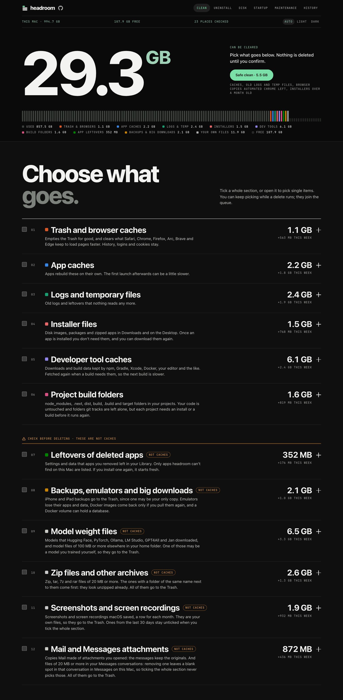
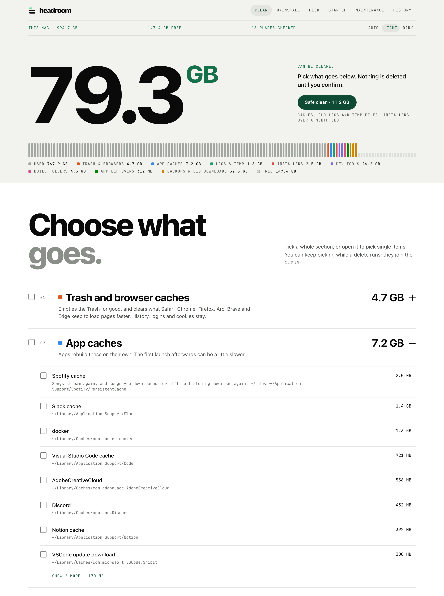

# headroom

My Mac ran out of space, so I made this to see what was eating it and clear the junk safely.
headroom finds caches and leftover files, shows how much space each one takes, and deletes
only what you tick. It can also uninstall apps, find what's big or duplicated, show what starts
up with your Mac, run a few macOS fixes, and tell you when space runs low.

It runs as a small page in your browser at `headroom.localhost`. Nothing about your files leaves
your Mac, and nothing gets deleted until you confirm. The only thing it ever asks the internet is
whether there's a new version.



## Getting started

You don't need Python or anything else, just macOS 12 or newer.

1. **Check which Mac you have.** Apple menu → About This Mac. If it says "Chip" (Apple M1, M2…)
   you have Apple Silicon. If it says "Processor" (Intel Core…) you have Intel.
2. **Download the zip** from the [latest release](https://github.com/ips610/headroom/releases/latest),
   under Assets:
   - `headroom-apple-silicon.zip` for Apple Silicon
   - `headroom-intel.zip` for Intel

   If you want to check the download first, get `SHA256SUMS` from the same place and run this
   in Terminal, in the folder with both files. It should say `OK`. (Safari unzips by itself and
   moves the zip to the Trash, so drag the zip back out first.)

   ```sh
   shasum -a 256 -c SHA256SUMS --ignore-missing
   ```
3. **Unzip it.** Safari does this by itself. Otherwise double-click the zip in Downloads. You get
   `headroom.app`.
4. **Move it to Applications.** Drag `headroom.app` onto Applications in the Finder sidebar. Don't
   run it from Downloads: the reminders and the `headroom.localhost` address are only set up
   when it runs from Applications.
5. **Open it the first time.** Double-click headroom in Applications. macOS says it can't check
   the app for malware, because I haven't paid Apple to notarise it. Click **Done** (not Move to
   Trash). Then open System Settings → Privacy & Security, scroll down to Security, and next to
   "headroom was blocked" click **Open Anyway**. Enter your password and click **Open Anyway**
   once more. You only do this once per download.
6. **Allow what it asks for.** headroom opens a page in your browser. macOS asks whether
   headroom may read Desktop, Documents and Downloads (that's where it finds build folders and
   old installers) and whether it may send notifications. Allow both. macOS may also say it
   added background items: those are the small helpers that make `headroom.localhost` and the
   reminders work. If you want headroom to clear the Trash, Safari's cache and the caches of apps
   like WhatsApp, also give it [Full Disk Access](#full-disk-access).
7. **Clean.** Wait for the scan, then press **Safe clean** for the easy wins, or tick what you
   want and press Delete. Nothing goes until you confirm.

After that, open it from the Dock, Launchpad or Spotlight, or just type `headroom.localhost` in
your browser.

### Updating

When you open headroom, it asks GitHub whether there's a newer version, at most once a day. If
there is, the top bar says a new version is out, with a **Get it** link. Maintenance → Updates
has a **Check for updates** button too.

To update, quit headroom (right-click its Dock icon → Quit), download the new zip, unzip it and
drag headroom into Applications. Click **Replace** when Finder asks. A new download may need
Open Anyway once more. Your settings, history and "Never offered" list stay.

### Uninstalling

Quit headroom and drag it from Applications to the Trash. Then paste this into Terminal to
remove its helpers, settings and history:

```sh
for agent in local.headroom.door local.headroom.watch local.localhost.door; do
  launchctl bootout gui/$(id -u)/$agent 2>/dev/null
  rm -f ~/Library/LaunchAgents/$agent.plist
done
rm -rf ~/Library/Application\ Support/headroom ~/Library/Logs/headroom ~/Library/Logs/headroom.log
```

If you also use harbor, keep `local.localhost.door` (it serves `harbor.localhost` too): take it
out of the first line.

## Using it

Open headroom and it scans your Mac. The numbers from last time show straight away, greyed
out, and each section fills in again as it's measured. Homebrew, Docker and the simulators can
take a while to answer, so the scan doesn't wait for them: you can already clean, and their rows
fill in when they're ready. Tick a whole section or open it to pick single items, then hit
Delete. A progress bar shows how it's going and you can stop it any time. Most of what you delete
doesn't go to the Trash, so check what you tick. What does go to the Trash, always: iPhone and
iPad backups, screenshots and screen recordings, archives, model files outside the tools' own
folders, and models in LM Studio, GPT4All, Jan and an Ollama folder without Ollama (you may have
put those there yourself). The confirm dialog says for each row where it goes.

If you'd rather have a safety net, turn on **Move cleaned files to the Trash instead of deleting
them** under Maintenance. Then nothing is deleted for good, and you get the space back when you
empty the Trash. Rows that only a command can clear (Homebrew, Docker, Ollama, simulators,
`git gc`) and the Trash itself are greyed out while it's on.

A section that grew a lot since about a week ago says so next to its size, like "+4.2 GB this
week", so you can see what's eating the disk before it's full.

Files that belong together show as one line: a month of screenshots, the archives in one folder,
or a model file that a training run left in a hundred folders under the same name. The line says
how many there are, how big they are together and where they are. Press **Show the 118 files** to
open it and you get every file with its own size, date and checkbox, largest first, so you can
keep the three runs you still need and tick the rest. Ticking the line itself ticks all of them.
Rows in these sections also have **Show in Finder**, so you can look before you decide.



If you just want space back, press **Safe clean**. It picks only what can't hurt: app caches,
old logs and temp files, the browser copies automated Chrome leaves behind, and installers you
downloaded over a month ago. It never picks your own files: no screenshots, models, archives or
backups. You still see the list before anything goes.

headroom has a Dock icon while it runs. Click it to bring the page back, and right-click it →
Quit (or ⌘Q) to stop headroom. Closing the tab stops it too.

You can also just type `headroom.localhost` in your browser, even when headroom is closed, and
it starts. macOS keeps that address free for it, so nothing actually runs until you visit. (If
Safari searches for it instead, type `headroom.localhost/` once.) The page itself lives on a port
of its own (8460, or the next free one if something else has that); the plain name is a tiny
redirect on port 80 that also knows `harbor.localhost`, my other app. [Uninstalling](#uninstalling) says how to remove those helpers.

The first scan may ask for access to Desktop, Documents and Downloads. That's how it finds
`node_modules` and build folders in your projects.

If an app is open, its cache is greyed out until you quit it, because the app would just
write it back. Build folders you used this week stay unticked when you tick the whole
section; tick them one by one if you really mean it. The same goes for screenshots and models
added or changed in the last 30 days, model files inside a git project, and Xcode's two newest
device support versions.

Don't want a row offered again? Hover it and press **Never offer**. It moves to "Never
offered" at the bottom of the list, where you can bring it back.

The page comes in Light and Dark. **Auto · Light · Dark** sits at the top right; Auto follows
your Mac.

### Reminders

headroom tells you when free space drops below 20 GB, and once a week, if Safe clean would
free 500 MB or more, it says how much. It checks every half hour in the background, never
repeats itself within six hours unless another 5 GB went, and never deletes anything on its
own. The first time you open headroom, macOS asks whether it may send notifications. Click one
and headroom opens. You can turn either reminder off, or change the 20 GB, under Maintenance.

### Full Disk Access

macOS keeps the Trash, Safari's and Chrome's caches, the caches inside sandboxed apps
(WhatsApp, Zoom, Teams…) and your iPhone and iPad backups behind Full Disk Access. If you want headroom to clear those, open
System Settings → Privacy & Security → Full Disk Access, switch on headroom (add it from
Applications with + if it isn't there), then quit and reopen headroom. Without it, headroom
just tells you what it couldn't see.

## What it cleans

| Section | What's in it |
| --- | --- |
| Trash and browser caches | the Trash, and the cache folders of Safari, Chrome, Firefox, Arc, Brave and Edge (never history, logins or cookies) |
| App caches | everything in `~/Library/Caches`, the cache folders of apps like Slack, VS Code and Notion, caches inside sandboxed apps, Spotify's and Adobe's media caches, qBittorrent's location database |
| Logs and temporary files | `~/Library/Logs`, qBittorrent's logs, temp files nobody has touched for a day, and the copies of itself that Chrome (or Edge, Brave, Chromium) leaves behind every time Selenium, Puppeteer or Playwright starts it, about 1 GB each. A copy a running browser was started from is left alone |
| Installer files | `.dmg`, `.pkg`, `.iso`, `.xip` and zipped apps in Downloads and on the Desktop, iPhone and iPad updates (`.ipsw`), and `.torrent` files you've already added to qBittorrent or that are over a month old |
| Developer tool caches | npm, Bun, Gradle, Maven, NuGet, gems, pub, Cargo, rustup, uv, Conda, Deno, Expo, Unity, Arduino, Go modules, Flutter, Xcode DerivedData, previews and device support (the two newest versions of each system stay unticked), old simulators and the caches inside shut-down ones, Docker build cache, Homebrew's old versions and packages nothing needs, old VS Code / Cursor / Windsurf extension versions, `~/.cache`, the datasets Hugging Face downloaded and the code torch.hub downloaded. A project's `.git` folder over 500 MB gets a row that packs it with `git gc` |
| Project build folders | `node_modules`, `.next`, `dist`, Rust `target`, Swift `.build`, Flutter `build` and `.dart_tool` |
| Leftovers of deleted apps | settings, caches, saved windows, containers and launch agents of apps that aren't on your Mac any more |
| Backups, emulators and big downloads | iPhone and iPad backups (these go to the Trash, since one may be your only copy), Android emulators and system images, iOS simulators, unused Docker images, stopped Docker containers and volumes no container uses, Xcode archives, unfinished downloads of torrents you removed from qBittorrent |
| Model weight files | models that Hugging Face, PyTorch, Ollama, LM Studio, GPT4All and Jan downloaded, one row each, and model files of 100 MB or more anywhere else in your home folder (`.gguf`, `.safetensors`, `.pt` and the like). A `.bin` or `.h5` only counts next to a `config.json` or `tokenizer.json`, or in a folder called `models` or `checkpoints`. The same file name in many folders (a training run) is one line that opens to the files |
| Zip files and other archives | `.zip`, `.tar`, `.tar.gz`, `.tgz`, `.tar.bz2`, `.tar.xz`, `.7z` and `.rar` of 20 MB or more, and a plain `.gz`, `.bz2` or `.xz` from 100 MB. The ones with a folder of the same name next to them come first, because they look unzipped already. Zipped apps in Downloads and on the Desktop stay under Installer files, and archives inside a git project aren't listed |
| Screenshots and screen recordings | the ones macOS itself made, in the folder it saves them to (the Desktop unless you changed it), one line per month that opens to the files, newest month first |

The last five aren't really cache. They won't come back on their own, so headroom keeps them
apart and warns you before deleting them.

Some things always go to the Trash and never straight off, whatever the switch says, because
they're yours or may be: iPhone and iPad backups, screenshots and screen recordings, archives,
model files outside the tools' own folders (a `.pt` in a project may be a model you trained, and
nothing can download that again), and models in LM Studio, GPT4All and Jan, which also hold the
ones you import. Hugging Face models and torch.hub checkpoints are deleted like any cache, since
those folders only hold downloads.

headroom finds model files and archives by asking Spotlight, so it doesn't walk your disk a
second time, and then checks every answer itself. If Spotlight doesn't answer, the section says
so. If it's switched off for the disk, those two sections just stay empty, and screenshots are
found by their names only, which misses ones macOS named in another language than English.

## The other tabs

- **Uninstall** lists your apps with their size, when you last used them and what they keep
  in your Library. Uninstalling moves the app and those files to the Trash, so you can change
  your mind. Apple's apps aren't listed, and an app has to be closed first.
- **Disk** shows the biggest folders in your home folder and Applications (click one to look
  inside), your largest files, downloads you haven't touched in 90 days, and duplicate files in
  Downloads, Desktop and Documents. You can show anything in Finder or move it to the Trash. For
  duplicates it keeps the newest copy unless you pick another, and skips files that live only in
  iCloud so nothing downloads.
- **Startup** lists what starts with your Mac or when you log in: your own launch agents and the
  ones for every user. You can turn your own off and on again; the others are shown only.
- **Maintenance** refreshes Quick Look, flushes DNS, rebuilds the icon cache or the Spotlight
  index. The ones that need your password ask through macOS's own dialog; headroom never
  sees it. Rebuilding Spotlight takes hours, so it asks first.
- **Maintenance** also holds the two reminders, and the switch that sends cleaned files to the
  Trash instead of deleting them. It's off unless you turn it on.
- **History** shows a chart of free space over time, with a dot wherever headroom freed some,
  then what grew since about a week ago (sections and single rows, biggest first), and lists
  everything it deleted or moved to the Trash, with when, what and where. Files that went together
  are one entry ("37 files named … moved to the Trash"), not one each. That list is kept in
  `~/Library/Logs/headroom/history.jsonl`. For "what grew", headroom keeps the sizes from one
  scan a day for 30 days. Until it has a scan from an earlier day it says "Not enough history
  yet", and if the one it compares with isn't about a week old it says how many days it is.

## What it won't touch

Your actual app data (settings, chats, local storage) unless you uninstall the app or it's a
deleted app's leftovers, Docker volumes a container still uses, virtualenvs, Apple's own caches and apps, and any
build folder that doesn't sit next to the file that proves what it is (`package.json`,
`Cargo.toml`, `Package.swift`, `pubspec.yaml`). If git tracks files in a build folder, it's
left alone. A deleted app's leftovers only show up when headroom is sure the app is gone.
With qBittorrent, it never touches your list of torrents, its settings or anything it finished
downloading, only the half-downloaded pieces of torrents that aren't in the list any more, and
nothing of it while qBittorrent is open.

A picture you named `screenshot.png` yourself isn't a screenshot to headroom: it only lists
files macOS marked as screen captures or named the way macOS names them, date and time included,
and only in the one folder macOS saves them to, never its subfolders. For model files and
archives it skips `~/Library`, anything inside an app or the Photos library, `node_modules`,
`.git` and other hidden folders, virtualenvs, conda and Flutter installs, and files that are only
in iCloud. It never opens an archive to look inside.

In a git repository it never deletes anything itself. It runs `git gc` and tells you how big
`.git` was before and after. Commits you can reach stay; git may remove unreachable ones older
than its grace period (two weeks, unless the repository says otherwise). It won't run that while
a rebase, merge, cherry-pick or bisect is half done or git holds a lock, nor in a partial clone or
a repository that shares its objects with another. And git never gets to run a program the
repository names: no hooks, no file-system monitor.

Next to Hugging Face's downloads, only what is known to be a download is offered. Your login and
whatever other tools keep in that folder stay. A browser copy that a running browser was started
from stays too.

## Is it safe?

I was careful here because it deletes things. The page never sends file paths to the app, only
the ids of rows it was shown, and the app only deletes what its own scan found. On top of that
it refuses anything outside your home folder or reached through a symlink, and only moves apps
to the Trash, never deletes them. The one exception outside the home and temp folders is the
browser copies automated Chrome leaves next to the temp folder, and there it accepts those
folders and nothing else. A symlink is never handed to Finder, because Finder would move what
it points at. With the Move to Trash switch on, headroom doesn't run `rm` at all, and if it
can't read its own settings it refuses to delete instead of guessing how the switch was set.

It only listens on this Mac (`127.0.0.1` and `::1`), and the page only works in a browser
headroom has signed in, so no website can talk to it. Being signed in takes two things: a
cookie, and a key the page keeps in the browser's storage for its exact address. A cookie alone
isn't tied to a port on localhost, so another program on your Mac could be sent it. The key
never leaves headroom's own page.

The first time, headroom signs your browser in by opening a tab itself. If you typed the
address, you'll see a second tab open and the first one say you can close it. After that the
browser stays signed in for 30 days, so typing `headroom.localhost` just works. Only your default
browser gets signed in this way.

Found a security problem? [SECURITY.md](SECURITY.md) says how to tell me privately.

## Building it yourself

You need Python 3.

```sh
git clone https://github.com/ips610/headroom.git
cd headroom
python3 install.py
```

That puts `headroom.app` in `/Applications`. It's signed with my own certificate ("IPS Local Apps")
when that's in the keychain, so macOS keeps Full Disk Access and notifications across rebuilds.
Without it, the app gets a throwaway signature and macOS asks again after every rebuild. Set
`SIGN_ID` to use a different certificate. `./run.sh` starts it straight from the folder, and
`python3 test_cleaner.py` runs the tests. They use a fake home folder and stand in for Finder,
so nothing real gets deleted or moved.

Measuring folders used to be the slow part, because `du` asks about one file at a time. So the
app carries a small program of its own, `headroom-size` (`launcher/size.swift`), that reads a
whole folder at once and works on several folders in parallel. It prints the same numbers as
`du -sk`, several times faster on big build folders. `install.py` builds it when there's a
Swift compiler, next to the Dock launcher. Without one, or from `./run.sh`, headroom just uses
`du`, and it also falls back to `du` for any folder the measurer isn't sure about. To try it from
source, build it with `launcher/build.sh` and point `HEADROOM_SIZE` at it. Only an app bundle's
own copy is used otherwise.

`./package.sh` makes the two zips for the Releases page, and `SHA256SUMS` to upload beside them.
It needs the python.org Python 3.11, a clean git tree and my certificate in the keychain
(`ALLOW_ADHOC=1` builds without it). PyInstaller and what it needs are pinned in
`requirements-build.txt`, with hashes, and installed fresh for every build. I build Apple Silicon
and Intel separately on purpose: a universal app made macOS warn that it "will not open in macOS 28".
